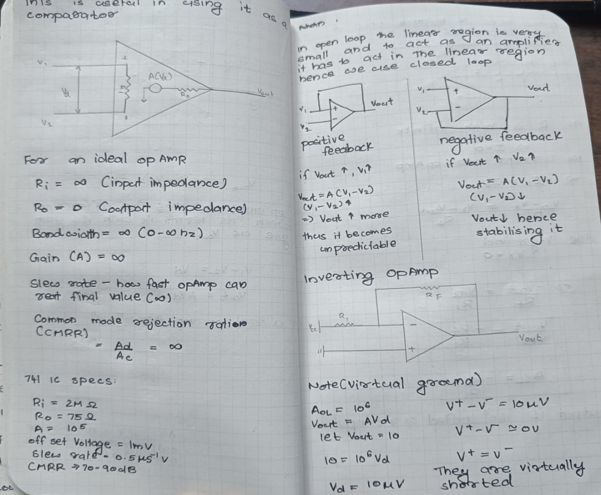
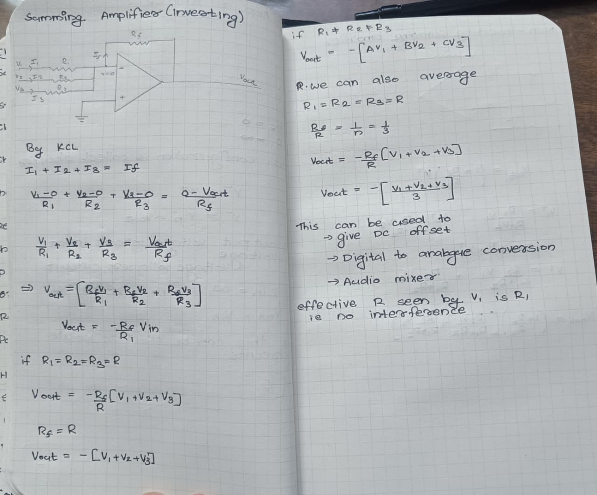
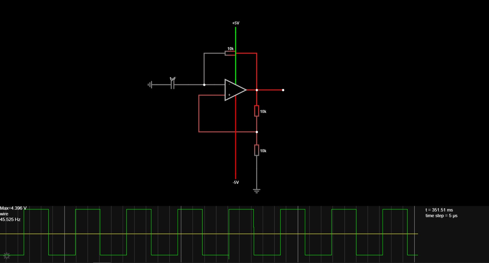
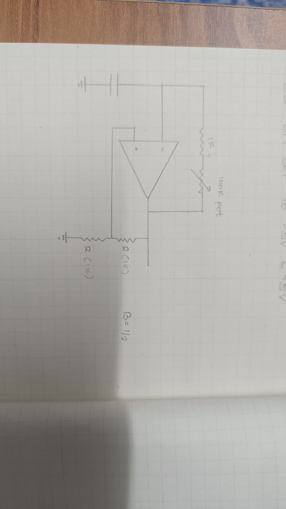
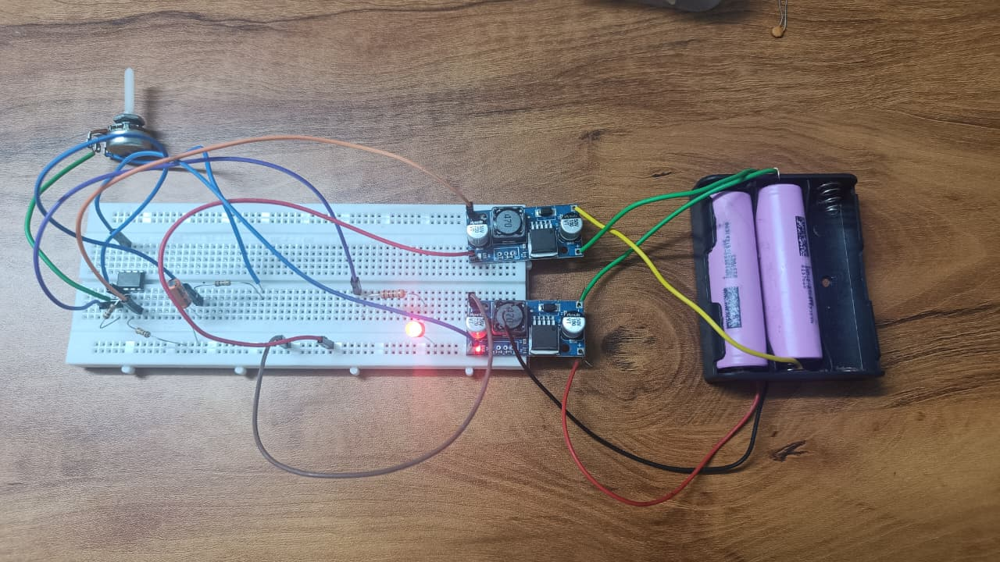

# October 24: Formalised the Plan of action 

I spent the whole day looking at options and running simulations to get the square wave generator using a NE555 up and running as i already own an NE555 i also blinkd an LED with variable timmings(also burnd the LED coz i was excited and forgot to put a resistor in series).After this i stumbled upon the rabbit hole of duty cycle as the NE555 cant produce a 50% duty cycle in astableas mode as when charging it goes through 2 resistors and when dischargin it only goes through one so that was thing i cracked my head over for a long time then i came across the circuit in which we can use 2 NE555 one acting as PWM to get 50% duty cycle though that had its own fleet of problem to tune such a circuit we need to have i think 4 potentiometers that would be a lot for the end user to tune finally i decided to make a circuit with just one NE555 but the duty cycle has an error of +-5% which i think is acceptable

**Total time spent: 5 hours**

# October 25: Came across some methods that i was unaware of earlier

Today in the morning i had a grueling realisation the thing is that the square wave generated by the NE555 can only swing from 0 to 5v and this was a problem yesterday i had not noticed this in the happiness of making the LED blink the thing is in a function generator the wave swings from positive to negative to i did some digging around and found that i can use a level shifter to shift the out put though that required a -ve power supply too.which would be a problem as now i would have to make a very complicated power deivery system to supply power to ne555 and the otherparts that require the -ve power so i again did some digging around and fonnd smt callsed as the relaxation oscillator this legit solved most of the problems as it uses a opamp to generate the square wave so now all the components can be driven from a single supply.The new problem is i didnt know opamps indept so that was smt i could solve so i started learning i found this great series on opamps on youtube by 'all about electronics' and today i could complete till the summming circuit which was nice i also skipped some and saw the video on astable multivibrator using an opamp and designed a small circuit to produce square waves and this circute produces square waves with 50% duty cycle which solves my previous problem only thing i noticed is that the square wave tends to become a pyramidal wave at higher frequencies which i think i will solve.i also thought of some ways to make the power delivery system as we need both -ve and +ve voltages the two ideas i could come across was (1)usig a charge pump (2)having batteries with flipped polarities,both have their own ups and down

**Total time spent: 6 hours**

# October 27: square wave works partially at leasr

Today i leared about equation for the relaxation oscillator and tuned it to the frequency i needed i am going to use a 2 capacitor system which can be switched using a 3 way switch also a 100k potentiometer.i made the breadboard prototype today and as i lacked a oscilloscope i cold only blink a led in periodic intervals with it though that worked out fine.i am planning to test it with an oscilloscope soon.another thing i wanted to shine some light on was the situation surrouding powersupply as im very much inexperinces with ac and transforers also the fact that its dangerous i am not using an ac source and a center tapped tranformer to generate the -ve and +ve voltags i need another this is that after some research i found out that charge pumps are also not viable as they have a rating of 50mA max and i was skeptical about the range.finallu i decided to use 2 batteries joied end to end such that the -ve end is in contact wwith the +ve end and one end i took as +ve the other -ve and the centerpoint as ground.which i then passed to 2 boost converters i have lying around to step up to 5v as lm358 has a range of 4.5v to 16v

**Total time spent: 4 hours**
