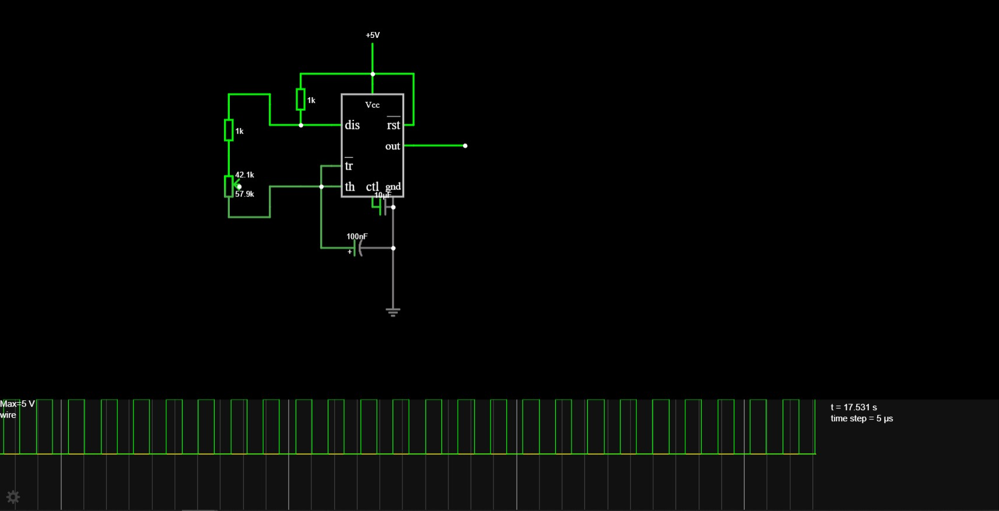

# October 24: Formalised the Plan of action 

I spent the whole day looking at options and running simulations to get the square wave generator using a NE555 up and running as i already own an NE555 i also blinkd an LED with variable timmings(also burnd the LED coz i was excited and forgot to put a resistor in series).After this i stumbled upon the rabbit hole of duty cycle as the NE555 cant produce a 50% duty cycle in astableas mode as when charging it goes through 2 resistors and when dischargin it only goes through one so that was thing i cracked my head over for a long time then i came across the circuit in which we can use 2 NE555 one acting as PWM to get 50% duty cycle though that had its own fleet of problem to tune such a circuit we need to have i think 4 potentiometers that would be a lot for the end user to tune finally i decided to make a circuit with just one NE555 but the duty cycle has an error of +-5% which i think is acceptable

**Total time spent: 5 hours**